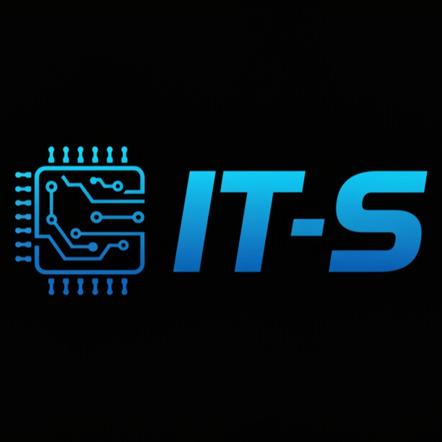

# IT-S

## Описание

IT-S  — это локальное приложение для сервисного центра: аналог CRM с базой данных на Postgres

## Особенности

- В приложении есть вкладки, между которыми можно переключаться: Продажи, Расходы, Финансовая Аналитика, Клиентская база, Услуги и цены и Главная. По умолчанию приложение открывается на Главной.
- В интерфейсе главной - задачи "В работе". Выполненные заказы скрыты и показываются по галочке "Показать выполненные".
- При раскрытии карточки на Главной видна сущность карточки с полями: Номер заказа, Дата приёма, Дата выдачи, Марка устройства, Модель устройства, ФИО клиента, Мобильный, Неисправность, После чего, Пометки, Цена.
- Если клиент в базе уже есть - то при вводе совпадающего мобильного он подтягивается из базы.

## Требования

Для запуска этого проекта вам понадобятся:

- Java 21
- Maven
- PostgreSQL

## Установка и запуск

### 1. Установите PostgreSQL

1. Скачайте установщик для Windows с [postgresql.org/download/windows](https://www.postgresql.org/download/windows/).
2. При установке задайте пароль `postgres` и оставьте порт `5432`. Остальное — по умолчанию.

С такими настройками приложение подключится само. Таблицы оно создаёт при первом запуске в отдельной схеме `its`.

Если пароль, порт или база у вас другие, создайте в папке проекта файл `db.properties`:

```
url=jdbc:postgresql://localhost:5432/postgres
user=postgres
password=ваш_пароль
```

Те же параметры можно задать переменными окружения `ITS_DB_URL`, `ITS_DB_USER`, `ITS_DB_PASSWORD`.

### 2. Запустите приложение

Из IntelliJ IDEA: откройте `src/main/java/its/App.java` и нажмите ▶ рядом с методом `main`.

Из командной строки:

```
mvn package
java -jar target/itsystem-1.0-SNAPSHOT.jar
```

Если появилось окно «Не удалось подключиться к PostgreSQL» — сервер не запущен либо не совпадают адрес, логин или пароль. Причина указана в последней строке окна.

### Демо-режим без PostgreSQL

Чтобы просто посмотреть интерфейс, запустите `src/test/java/its/DemoApp.java` — в IDEA кнопкой ▶ или командой:

```
mvn test-compile exec:java "-Dexec.classpathScope=test" "-Dmain.class=its.DemoApp"
```

Приложение откроется с примерами заказов, клиентов, продаж и расходов. Данные в демо-режиме временные: после закрытия окна они пропадают.

## Как пользоваться

### Главная

- **Новый заказ** — кнопка «+ Новый заказ». Обязательны дата приёма, мобильный и ФИО клиента. Номер заказа присваивается сам.
- **Клиент из базы** — введите мобильный в любом формате (`8 999…`, `+7 (999)…`): если клиент уже есть, ФИО подставится. Нового клиента приложение занесёт в базу при сохранении заказа.
- **Карточка** — щелчок по заголовку раскрывает все поля заказа.
- **«Выполнено»** — ставит сегодняшнюю дату выдачи и убирает заказ с Главной.
- **«Показать выполненные»** — галочка рядом с поиском открывает справа колонку выполненных заказов. Там же кнопка «Вернуть в работу».
- **«Изменить» и «Удалить»** — в раскрытой карточке.
- **Цена** — необязательное поле: её можно внести позже через «Изменить».
- **Поиск** — по номеру заказа, устройству, ФИО или телефону.

Даты вводятся в формате `ДД.ММ.ГГГГ`.

### Продажи

Журнал продаж товаров и услуг: дата, наименование, количество, цена и, при желании, клиент. Наименование можно выбрать из прайс-листа — цена подставится.

### Расходы

Журнал трат: дата, статья расхода (аренда, запчасти, зарплата и т. п.) и сумма. Все записи учитываются в финансовой аналитике по своей дате.

### Финансовая аналитика

Выручка за сегодня, месяц, год и всё время, средний чек, расходы и прибыль (выручка минус расходы) за месяц, год и всё время, график выручки и расходов по месяцам и самые доходные позиции. Убыток выделяется красным. В выручку входят:

- все записи со вкладки «Продажи»;
- заказы с Главной в статусе «Выполнено», у которых указана цена, — по дате выдачи.

Не вносите один и тот же ремонт и ценой в заказ, и отдельной продажей: он посчитается дважды.

### Клиентская база

Список клиентов с телефонами и числом заказов.

### Услуги и цены

Прайс-лист. Из него подставляется цена при оформлении продажи.

